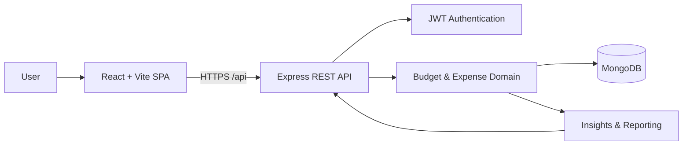

# Application Architecture

## Product direction
A personal budget operations workspace for planning allocations, recording transactions, monitoring utilization, and reviewing explainable spending signals.

## System context


## Repository structure
```text
client/
  src/
    app/             # app composition and route guards
    components/      # reusable UI primitives and feedback states
    features/
      auth/           # login and registration
      dashboard/      # summary and utilization overview
      budgets/        # budget lifecycle
      expenses/       # transaction lifecycle and filtering
      reports/        # reporting and export
    layouts/          # authenticated workspace shell
    lib/              # API client, formatting, constants
    styles/           # design tokens and global styles
server/
  src/
    config/           # environment and database configuration
    middleware/       # authentication, validation, errors
    models/           # persistence schemas
    modules/
      auth/            # authentication use cases and routes
      budgets/         # budget use cases and routes
      expenses/        # expense use cases and routes
      dashboard/       # aggregation and insights
    utils/             # shared helpers
```

## Backend boundaries
- Routes are HTTP adapters: parse input, call a module service, return a response.
- Services own business rules and orchestration.
- Models own persistence shape and indexes.
- Middleware owns cross-cutting concerns (auth, rate limits, errors).
- Every read/write query is scoped by authenticated user ID.
- Expenses must reference a budget owned by the same user.
- Budget deletion explicitly removes dependent expenses (documented cascade behavior).

## Domain rules
- Allocation must be greater than zero.
- Expense amount must be greater than zero.
- Utilization = expenses / allocation × 100.
- Remaining = allocation − expenses; negative values are retained to show overspending.
- Financial insights are deterministic rules and must be labelled as such until a genuine model/provider is integrated.

## Quality gates
1. Frontend production build.
2. Backend JavaScript syntax validation.
3. API integration tests for auth, ownership isolation, and budget/expense lifecycle.
4. Manual smoke test against a configured MongoDB database.
5. Deployment smoke test for frontend and API health.

## Deployment topology
- Vercel serves the static React application.
- A Node-compatible service runs the Express API.
- MongoDB Atlas stores application data.
- Secrets (MONGO_URI, JWT_SECRET) are server-only environment variables. Never put secrets in VITE_* variables or commit .env files.
